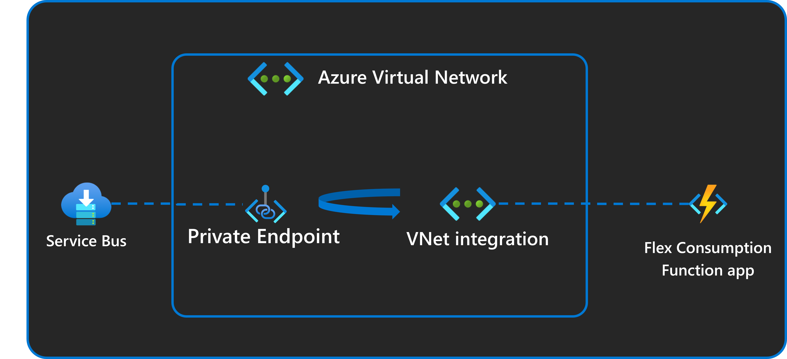
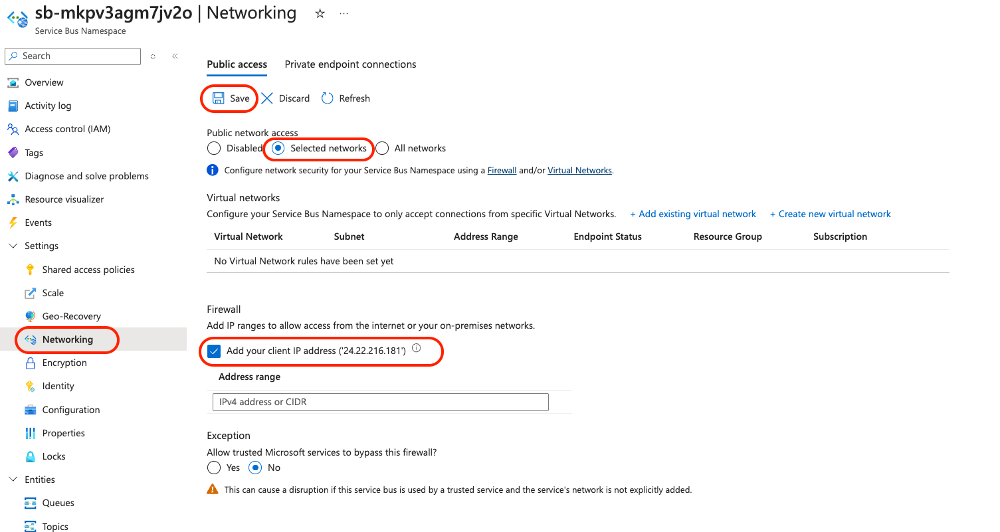
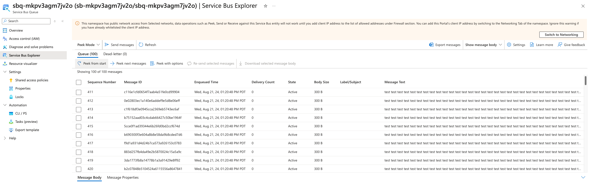
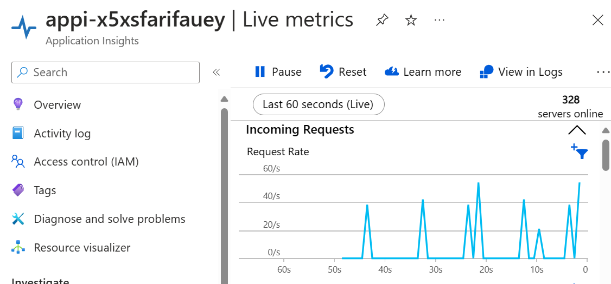

# Azure Functions .NET C# Service Bus Trigger using Azure Developer CLI

This template repository contains a Service Bus trigger reference sample for functions written in .NET C# and deployed to Azure using the Azure Developer CLI (`azd`). The sample uses managed identity and a virtual network to make sure deployment is secure by default. This sample demonstrates these two key features of the Flex Consumption plan:

* **High scale**. A low concurrency of 1 is configured for the function app in the `host.json` file. Once messages are loaded into Service Bus and the app is started, you can see it scale out, with each instance processing one message at a time.
* **Virtual network integration**. The Service Bus that this Flex Consumption app reads events from is secured behind a private endpoint. The function app can read events from it because it is configured with VNet integration. All connections to Service Bus and to the storage account associated with the Flex Consumption app also use managed identity connections instead of connection strings.

When `APPLICATIONINSIGHTS_CONNECTION_STRING` is set, the worker exports
OpenTelemetry data to Azure Monitor and authenticates with the function app's
managed identity through the dedicated `AzureMonitorExporter` settings.



This project is designed to run on your local computer. You can also use GitHub Codespaces if available.

This sample processes queue-based events, demonstrating a common Azure Functions scenario where batch processing jobs are queued up with instructions for processing. The function app processes each message with a simulated delay to showcase the scaling capabilities.

> [!IMPORTANT]
> This sample creates several resources. Make sure to delete the resource group after testing to minimize charges!

## Prerequisites

* [.NET 10 SDK](https://dotnet.microsoft.com/download/dotnet/10.0)
* [Azure Functions Core Tools v4](https://learn.microsoft.com/azure/azure-functions/functions-run-local?tabs=v4%2Clinux%2Ccsharp%2Cportal%2Cbash#install-the-azure-functions-core-tools)
  (4.16.0 or later)
* To use Visual Studio Code to run and debug locally:
  * [Visual Studio Code](https://code.visualstudio.com/)
  * [Azure Functions extension](https://marketplace.visualstudio.com/items?itemName=ms-azuretools.vscode-azurefunctions)
  * [C# extension](https://marketplace.visualstudio.com/items?itemName=ms-dotnettools.csharp)
* [Azure CLI](https://learn.microsoft.com/cli/azure/install-azure-cli) (for deployment)
* [Azure Developer CLI](https://learn.microsoft.com/azure/developer/azure-developer-cli/install-azd?tabs=winget-windows%2Cbrew-mac%2Cscript-linux&pivots=os-windows)
* An Azure subscription with Microsoft.Web and Microsoft.App [registered resource providers](https://learn.microsoft.com/azure/azure-resource-manager/management/resource-providers-and-types#register-resource-provider)

## Initialize the local project

You can initialize a project from this `azd` template in one of these ways:

* Use this `azd init` command from an empty local (root) folder:

    ```shell
    azd init --template functions-quickstart-dotnet-azd-service-bus
    ```

    Supply an environment name, such as `flexquickstart` when prompted. In `azd`, the environment is used to maintain a unique deployment context for your app.

* Clone the GitHub template repository locally using the `git clone` command:

    ```shell
    git clone https://github.com/Azure-Samples/functions-quickstart-dotnet-azd-service-bus.git
    cd functions-quickstart-dotnet-azd-service-bus
    ```

    You can also clone the repository from your own fork in GitHub.

## Provision Azure resources

The local run uses the Service Bus queue that you provision in Azure, so provision the resources first.

1. Sign in with both the Azure Developer CLI and the Azure CLI. The generated message sender uses `az rest`, which requires a separate Azure CLI sign-in:

    ```shell
    azd auth login
    az login
    ```

2. Choose whether to enable VNet integration:

    **To run locally and send test messages from your computer (public endpoints):**

    ```shell
    azd env set VNET_ENABLED false
    ```

    **For the secure deployment with VNet integration and private endpoints:**

    ```shell
    azd env set VNET_ENABLED true
    ```

    > [!NOTE]
    > If you don't set `VNET_ENABLED`, the deployment asks you to make an explicit choice. When `VNET_ENABLED` is `true`, public network access to Service Bus is disabled, so the local run and the generated `send-message` scripts can't connect from your computer.

3. Provision the resources:

    ```shell
    azd provision
    ```

    You're prompted to supply these required deployment parameters:

    | Parameter | Description |
    | ---- | ---- |
    | _Environment name_ | An environment that's used to maintain a unique deployment context for your app. You won't be prompted if you created the local project using `azd init`. |
    | _Azure subscription_ | Subscription in which your resources are created. |
    | _Azure location_ | Azure region in which to create the resource group that contains the new Azure resources. Only regions that currently support the Flex Consumption plan are shown. |

    The signed-in `azd` user is also granted data access to the Service Bus namespace, storage account, and Application Insights so that you can run and debug locally. These role assignments use the `User` principal type, so provision as an interactive user rather than a service principal.

    After provisioning completes, a post-provision script creates `src/local.settings.json` with the provisioned Service Bus settings, and generates a test script in the root folder: `send-message.ps1` on Windows or `send-message.sh` on Linux/macOS. If `src/local.settings.json` already exists, the script doesn't change it; if the file doesn't reference the provisioned namespace and queue, the script prints the values to use. The generated file looks like this:

    ```json
    {
        "IsEncrypted": false,
        "Values": {
            "AzureWebJobsStorage": "UseDevelopmentStorage=true",
            "FUNCTIONS_WORKER_RUNTIME": "dotnet-isolated",
            "ServiceBusConnection__fullyQualifiedNamespace": "<your-namespace>.servicebus.windows.net",
            "ServiceBusQueueName": "<your-queue-name>"
        }
    }
    ```

4. Navigate to the `src` folder and restore the .NET packages:

    ```shell
    cd src
    dotnet restore
    ```

## Run your app from the terminal

1. Start the Azurite storage emulator. You can use the [Azurite extension](https://marketplace.visualstudio.com/items?itemName=Azurite.azurite) in Visual Studio Code or run `azurite` in a separate terminal.

2. From the `src` folder, run this command to start the Functions host locally:

    ```shell
    func start
    ```

3. The function will start and display the available functions. You should see output similar to:

    ```
    Functions:
        ServiceBusQueueTrigger: serviceBusTrigger
    ```

    When `VNET_ENABLED` is `false`, the local function connects to the provisioned Service Bus queue by using your Azure sign-in.

4. When you're done, press Ctrl+C in the terminal window to stop the `func` host process.

## Run your app using Visual Studio Code

1. Open the project root folder in Visual Studio Code.
2. Start the Azurite storage emulator.
3. Press **Run/Debug (F5)** to run in the debugger.
4. The Azure Functions extension will automatically detect your function and start the local runtime.
5. When `VNET_ENABLED` is `false`, the function connects to the provisioned Service Bus queue.

## Source Code

The Service Bus trigger function is defined in [`src/ServiceBusQueueTrigger.cs`](./src/ServiceBusQueueTrigger.cs). The function uses the `[ServiceBusTrigger]` attribute to define the trigger configuration.

This code shows the Service Bus queue trigger function:

```csharp
[Function("ServiceBusQueueTrigger")]
public async Task Run([ServiceBusTrigger("%ServiceBusQueueName%", Connection = "ServiceBusConnection")]
    string messageBody, FunctionContext context)
{
    _logger.LogInformation("C# ServiceBus Queue trigger start processing a message: {messageBody}", messageBody);

    // Simulate processing time with a 30-second delay to demonstrate scaling behavior
    await Task.Delay(TimeSpan.FromSeconds(30));

    _logger.LogInformation("C# ServiceBus Queue trigger end processing a message");
}
```

Key aspects of this code:

* The `[ServiceBusTrigger]` attribute configures the function to trigger when messages arrive in the specified Service Bus queue
* The queue name is read from the `ServiceBusQueueName` environment variable using the `%ServiceBusQueueName%` syntax
* The connection is configured by the `ServiceBusConnection` settings; in
  Azure, these use managed identity
  (`ServiceBusConnection__fullyQualifiedNamespace`) instead of a connection
  string
* The function includes a 30-second `await Task.Delay(TimeSpan.FromSeconds(30))` delay to simulate message processing time and demonstrate the scaling behavior
* Each message body is logged for debugging purposes using structured logging

The function configuration in [`src/host.json`](./src/host.json) sets `maxConcurrentCalls` to 1 for the Service Bus extension:

```json
{
  "extensions": {
    "serviceBus": {
        "maxConcurrentCalls": 1
    }
  }
}
```

This configuration limits each function instance to one message at a time, so the Flex Consumption plan can scale out to more instances when multiple messages are queued.

## Deploy to Azure

Run this command to deploy your function app code to the resources that you provisioned:

```shell
azd deploy
```

You can also use `azd up` to provision the Azure resources and deploy your code in one step.

After deployment completes successfully, `azd` provides you with the URL endpoints and resource information for your new function app.

## Test the solution

1. **Send test messages**:
   * When `VNET_ENABLED` is `false`, run the script that the post-provision step generated in the root folder. It already contains your Service Bus namespace and queue name:

     ```shell
     ./send-message.sh
     ```

     On Windows (PowerShell):

     ```powershell
     ./send-message.ps1
     ```

     The function running locally or in Azure logs output similar to:

     ```output
     C# ServiceBus Queue trigger start processing a message: Hello from the CLI
     C# ServiceBus Queue trigger end processing a message
     ```

   * When `VNET_ENABLED` is `true`, Service Bus public network access is disabled. Send messages from a client that can reach the Service Bus private endpoint. To use the Service Bus Explorer in the Azure portal instead, you'll need to configure your client IP address in the Service Bus firewall:
     

     Then follow [Use Service Bus Explorer to run data operations on Service Bus](https://learn.microsoft.com/en-us/azure/service-bus-messaging/explorer) to send messages and peek messages from the queue.
     

2. **Monitor scaling behavior**:
   * Send 1,000 messages using the Service Bus Explorer
   * Open Application Insights live metrics and observe the number of instances ('servers online')
   * Notice your app scaling the number of instances to handle processing the messages
   * Given the purposeful 30-second delay in the app code, you should see messages being processed in 30-second intervals once the app's maximum instance count (default of 100) is reached
   

The sample telemetry should show that your messages are triggering the function and making their way from Service Bus through the VNet into the function app for processing.

## Redeploy your code

You can run the `azd up` command as many times as you need to both provision your Azure resources and deploy code updates to your function app.

> [!NOTE]
> Deployed code files are always overwritten by the latest deployment package.

## Clean up resources

When you're done working with your function app and related resources, you can use this command to delete the function app and its related resources from Azure and avoid incurring any further costs:

```shell
azd down
```

## Resources

For more information on Azure Functions, Service Bus, and VNet integration, see the following resources:

* [Azure Functions documentation](https://docs.microsoft.com/azure/azure-functions/)
* [Azure Service Bus documentation](https://docs.microsoft.com/azure/service-bus/)
* [Azure Virtual Network documentation](https://docs.microsoft.com/azure/virtual-network/)
